# Financial Note: what changed since the mock-up

**The short version:** the case study shows a quick-note app for spending. The product today is a **private, on-device record of everything you own**, and spending is one part of it.

> From "write down what you spent" to "know what you have, without anyone else knowing it."

---

## At a glance

| | Case study (mock-up) | Now (built) |
|---|---|---|
| **Focus** | Recording spending with a typed note | Managing assets: money, gold, dollars, coins, savings, loans, belongings |
| **Status** | "Mobile · iOS prototype", designed, not released | Native iPhone app (SwiftUI, iOS 26), runs on a real iPhone, plus a web version at note.phamnguyen.space |
| **Assets** | One screen in four groups. The pilot found it "hard to read" | The centre of the app: groups as a ring, live prices, history, total worth over time |
| **Where data lives** | Not covered | Only on the phone. No account, no server. Backup goes to your own iCloud folder |
| **Privacy** | "Hidden by default" balance | Hidden on open, double-tap to hide any amount, made-up data sets for showing the app |
| **AI** | Parses a typed note | Also reads receipts, bank screenshots and savings books, on the phone (Apple Intelligence) |

---

## Why the focus moved to assets

- **The pilot said so.** "Assets was hard to read" was the one section never researched, and the case study named it as the next round. That is where most of the work went.
- **The research already pointed there.** Participants described savings as a buffer, "more choices if your parents get sick". What they wanted to see was what they have, not what they spent.
- **Assets are the most sensitive data.** People share spending habits easily but not how much gold or savings they hold. So the app had to stay on the phone.

---

## What was upgraded

### 1. Assets became the centre (Finance)

- **Four groups as a ring:** Available, Growing, Set aside and Owed. The biggest share sits in the middle. Tap a group to see only its assets.
- **Assets held in units, not just amounts:** gold by chỉ, phân and lượng, US dollars and coins.
  - Today's price is downloaded and the value updates itself.
  - A gold premium setting covers the gap between SJC and the world price.
  - You can keep your own value instead of the market one.
- **History you can trust:**
  - Every asset keeps a record of put-ins, take-outs and value changes, and you can add one for an earlier date.
  - Savings deposits are shown as dots.
  - A Total Asset line shows how what you own has changed over time.
- **Adding an asset is a conversation, not a form:**
  - Type "vàng SJC 15tr" or "tiết kiệm TPBank 50 triệu" and the app picks the group, the name and the amount.
  - Or scan or photograph a bank balance screen or a savings book.
- **A step-by-step add flow:** name (the group is picked for you), then the amount on a number pad built from Figma, then the date, then a note.
- **The number pad handles currencies,** with a line showing what the amount is in đồng.

### 2. Things you own (new)

- **Belongings, beyond money:** things that hold value, everyday things, and collections.
- **Collections such as Lego sets,** with the set picture, each piece counted once.
- **Worth with no market lookups and no advice:**
  - The app shows what a thing is worth today and what a quick sale might fetch.
  - The value is your estimate, what you paid, or what's left after it loses some value each year.
  - It never tells you to buy or sell.

### 3. Debts and family, side by side

- **Instalments and family loans:**
  - Each family loan has its own interest and a history of money in and out.
  - What you owe is shown as one pie, by source.
- **"Taken care of" stays:** money sent home is still care given, not spending.

### 4. Local and private by design

- **On the phone only:** the app has no account, no sign-up and no server, and everything is stored on the iPhone.
- **Nothing about you goes out:**
  - The only downloads are public price lists (exchange rates, world gold price, coins) and Lego set pictures.
  - The app sends nothing about you or your money.
- **AI runs on the phone:** receipts, screenshots and savings books are read by Apple Intelligence on the device. Nothing is uploaded.
- **Amounts hidden by default:** the app can open with every amount hidden, and you double-tap to hide or show.
- **Your own backup:**
  - After every change, the app writes a copy (JSON, plus CSV files for Excel or Numbers) to a folder you choose, such as iCloud Drive.
  - You can restore from that folder or from any backup file.
- **Data sets for showing the app:** you can switch between your own data, an empty app and full made-up data. Demos and screenshots never show real numbers.

### 5. Spending is still there, lighter

- **Today:** the day, month or year at a glance, with the typed note still the fastest way in.
- **Scan:**
  - Scan a transfer QR and the app opens your bank app.
  - Paying still happens at the bank, the boundary the case study kept on purpose.
- **Due:** bills grouped by kind, a filter by where you pay, and "Coming up by year". Still dates, not warnings.

### 6. Craft

- **Native look:** SwiftUI with Apple's Liquid Glass.
- **One design system:**
  - Colours and type sizes come from Figma tokens.
  - The iPhone app and the web share the same tokens.
- **Dark mode, Dynamic Type and accessibility labels.**

---

## What stayed the same

- **AI is a scribe, not a coach.** It records what you say and stays quiet until asked.
- **Hidden by default.** Now stronger: every amount, not only the balance.
- **Family is care, not spending.**
- **No red alarms.** Losses show in grey.
- **No investment tips.** Left out on purpose.

---

## Not tested yet

The pilot (6 testers) ran on the mock-up. Nobody has tested the asset-centred version yet, so the Evaluation section should stay as it is. The next round starts with Finance and Things you own.

---

## Suggested edits to the case study page

1. **Platform:** change "Mobile · iOS prototype" to "iOS app (SwiftUI) + web".
2. **Status:** change "Designed · not yet released" to "Built · in personal use, not on the App Store".
3. **Hero image:** replace the old List / All / Expense / Receive screen with the new Finance screen.
4. **New section after Evaluation: "What changed after the pilot".** Tell the assets story: the finding, the redesign, and why everything stays on the phone.
5. **Showcase:** add Finance (ring and units), Things you own, Add asset (say it or scan it), and Backup & privacy.

---

## Screenshots

These were taken on 26 Nov 2026 on the iPhone 17 Simulator (iOS 27.2) with the made-up Example data, so no real numbers appear.

- **Status bar:** set to 9:41 with a full battery.
- **Files:** `case-study-shots/`, as PNGs at 1206 × 2622.

### Assets at the centre

| | Light | Dark |
|---|---|---|
| **Finance overview:** Total Asset line over 6 months, net worth vs debt | 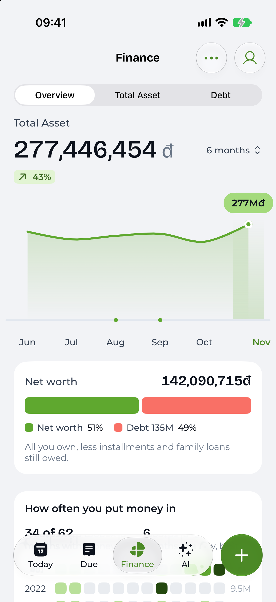 | 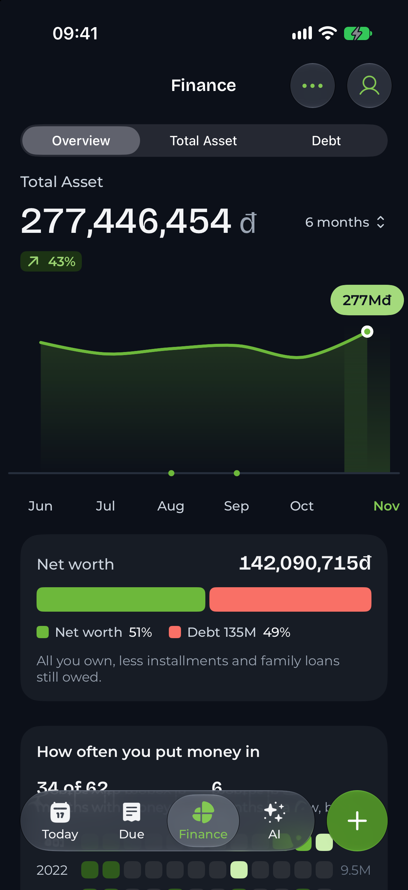 |
| **Total Asset:** the four groups as a ring, the asset list with gain or loss, Sync for today's prices | 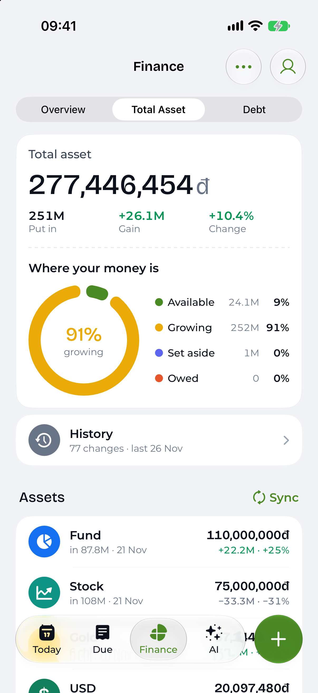 | 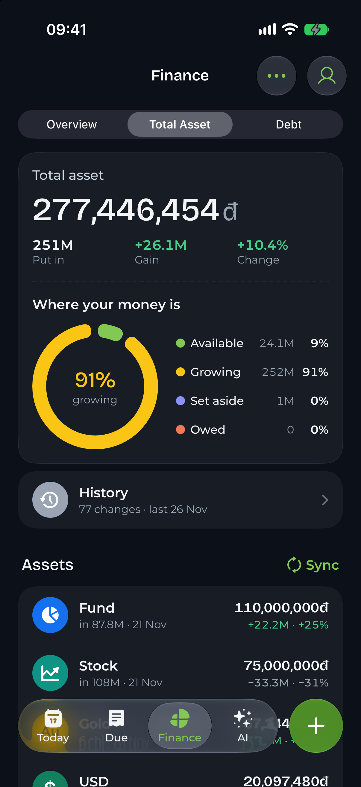 |
| **Where your money is, and how often you put money in** (deposit dots by month) | 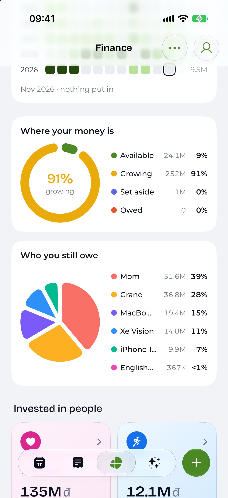 | — |

### Family, yourself and things you own

| | Light | Dark |
|---|---|---|
| **Invested in people** (family and yourself) and **Things you own** (holds value, everyday, collections). Kept apart from Total Asset. | 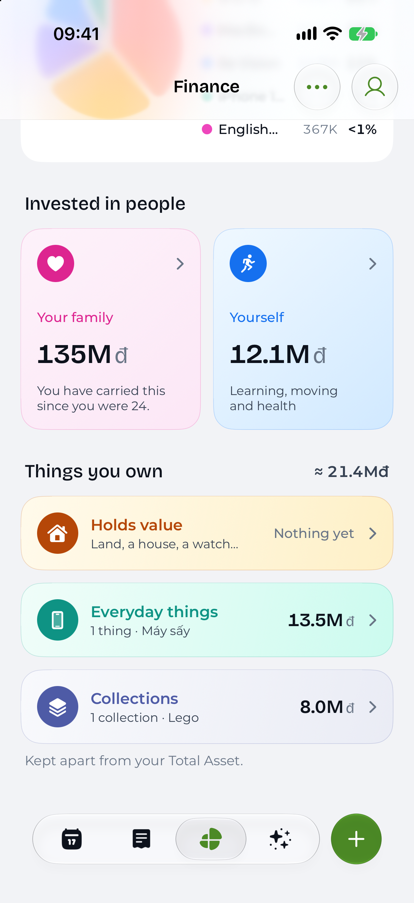 | 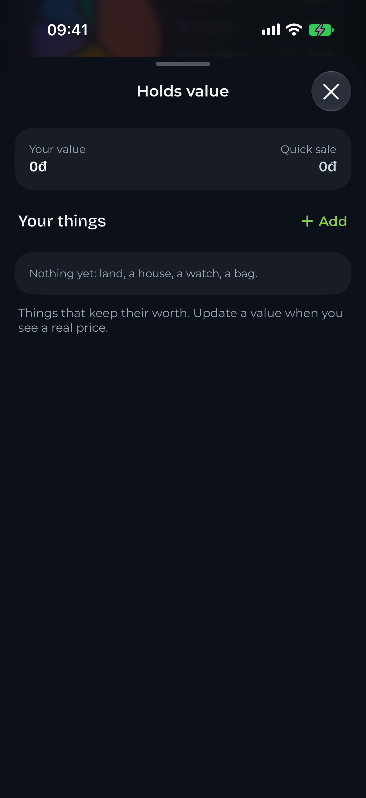 |
| **A Lego collection:** each set with its picture, condition, your value and a quick-sale value | 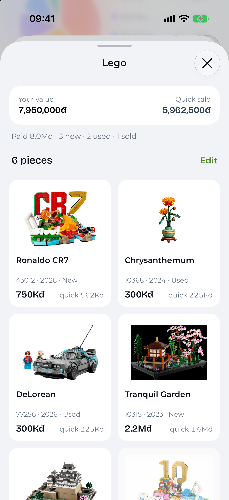 | 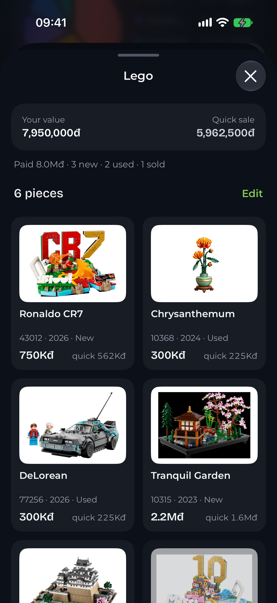 |
| **Debt:** still to pay, who you still owe (instalments and family), family loans with interest | 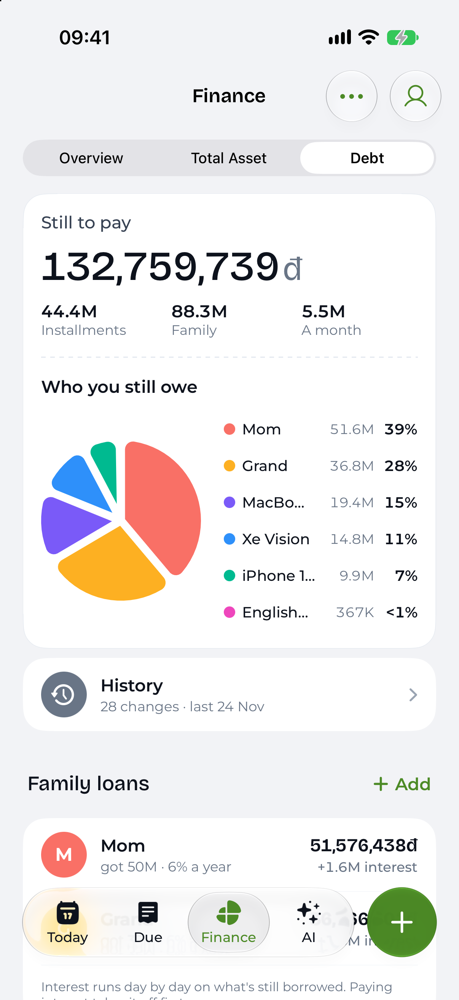 | 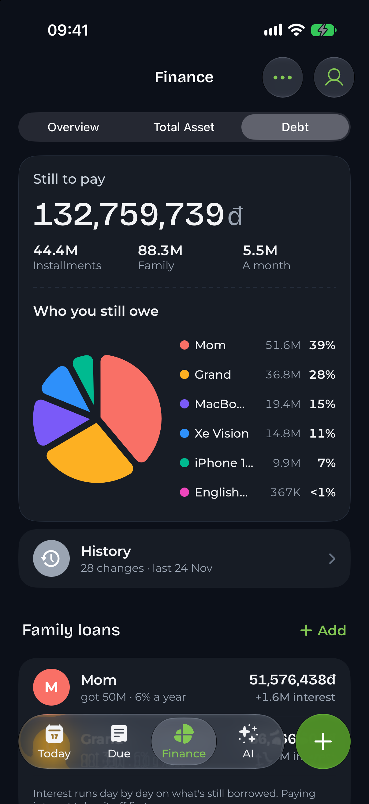 |

### Adding an asset

| | Light |
|---|---|
| **The + menu:** Quick note, Scan, Belonging, New asset | 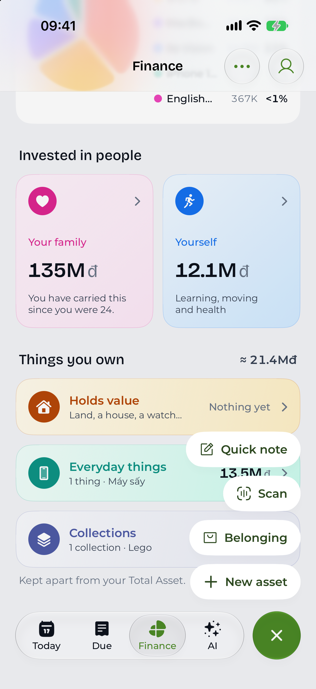 |
| **"What is it?":** type your own ("vàng SJC 15tr") or pick from the four groups | 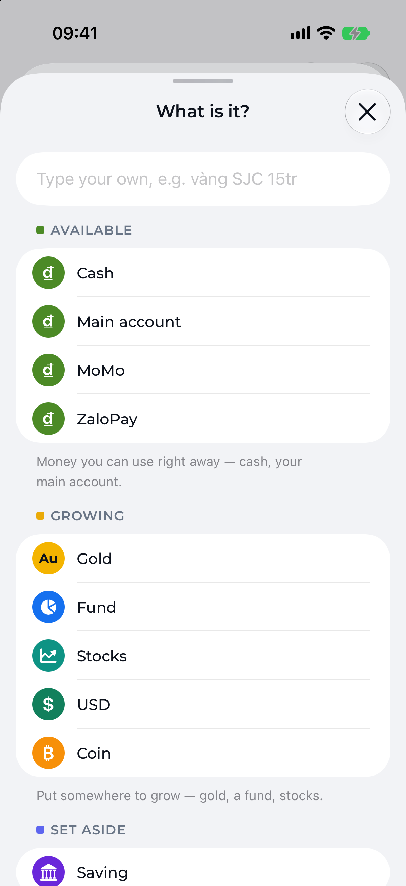 |
| **Gold picked:** the group is filled in, the amount is held in chỉ, and the number pad comes up | 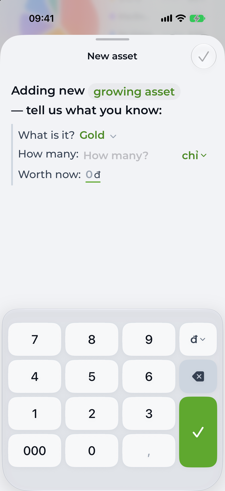 |

### Not captured yet

- Asset detail, with its history
- Profile › Backup & restore. This screen is still uncommitted, and the Example set should not be used to show a backup folder.
- Today (Monthly) and Due
- Scan with a bank-balance photo
